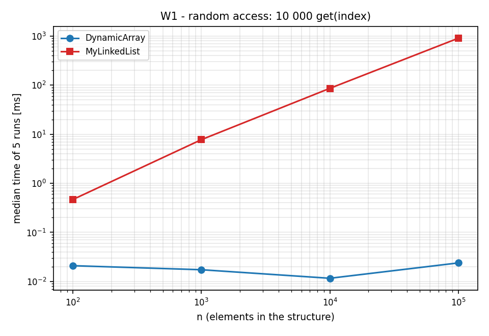
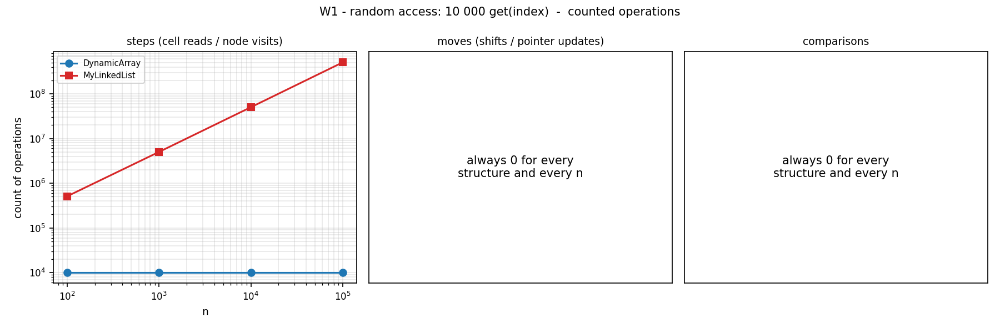
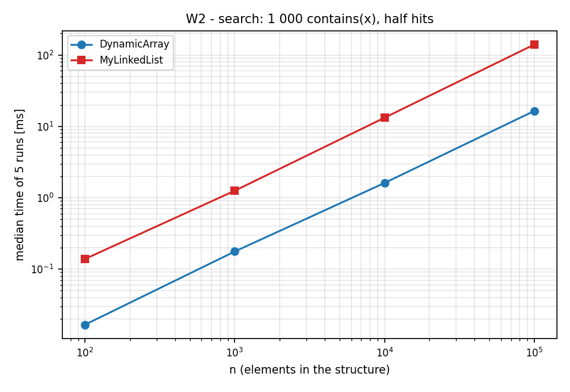
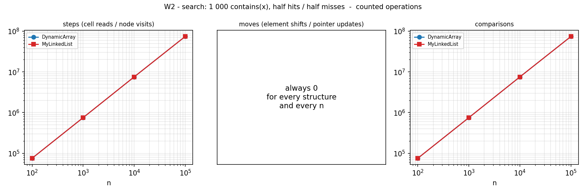
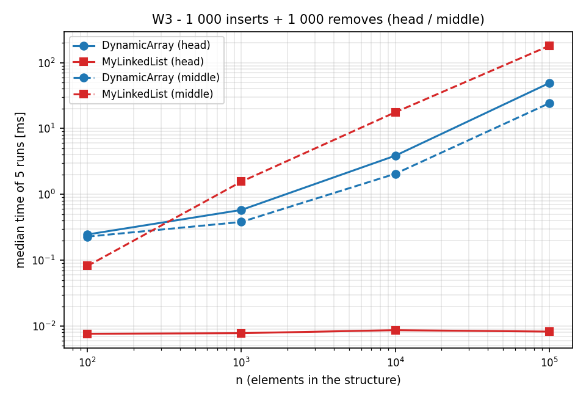
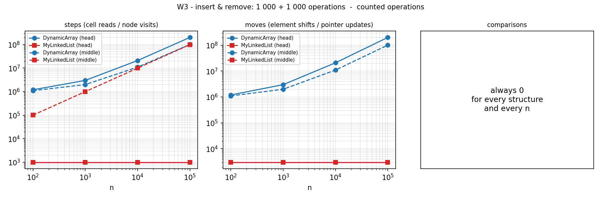
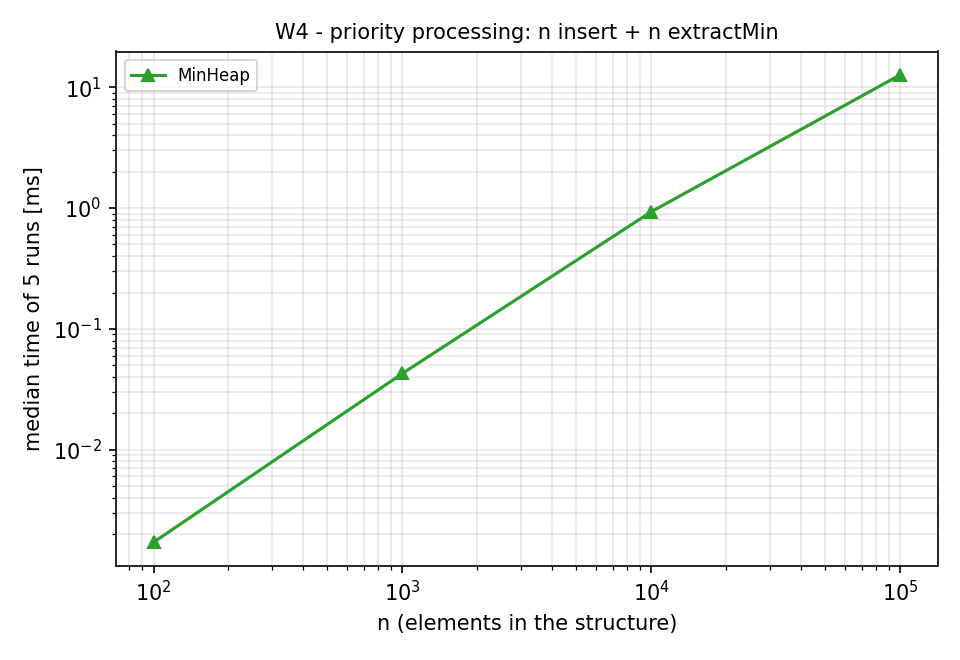
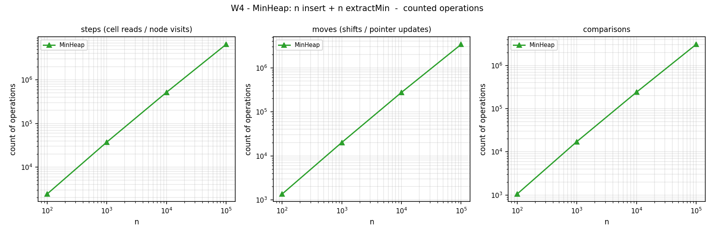

# Assignment 2 - Data Structures: Report

**Course:** Design and Analysis of Algorithms  **Author:** _name surname, group_
**Code:** `DynamicArray`, `MyLinkedList`, `MinHeap` (all from scratch, `int[]`/`int` only, no `java.util` collections)

**Machine used for every number below:** Intel Xeon @ 2.1 GHz (1 vCPU VM), L1d 48 KiB, L2 2 MiB, OpenJDK 21, `Random(42)`.
All raw data is in `results/results.csv`; every chart is generated from it by `scripts/plot.py`.

---

## 1. Design in one paragraph

`DynamicArray` doubles its `int[]` when full. `MyLinkedList` is a singly linked list with a `tail` pointer (so `add(x)` is O(1)); indexed operations walk from the head. `MinHeap` is a binary heap in an `int[]` (children of `i` are `2i+1`, `2i+2`) that also doubles when full. `DynamicArray` and `MyLinkedList` implement one interface (`IntList`), so the same benchmark code runs on both. Invalid indices throw `IndexOutOfBoundsException`; `peekMin`/`extractMin` on an empty heap throw `IllegalStateException`. Shifts are written as explicit loops (not `System.arraycopy`) so that every shifted element is really counted.

## 2. Complexity table

*Average* = uniformly random valid index (for `contains`: uniformly random hit position, or a miss). n = current size.
Θ is used whenever the bound is tight for that case; "amort." = amortized over a sequence of operations.

| Structure | Operation | Best | Average | Worst | Aux. space |
|---|---|---|---|---|---|
| DynamicArray | `add(x)` | Θ(1) | Θ(1) amort. | Θ(n) (resize) | O(1); Θ(n) during a resize |
| | `add(index,x)` | Θ(1) (index = n) | Θ(n) | Θ(n) | O(1); Θ(n) during a resize |
| | `remove(index)` | Θ(1) (last) | Θ(n) | Θ(n) (index 0) | O(1) |
| | `get(i)` | Θ(1) | Θ(1) | Θ(1) | O(1) |
| | `contains(x)` | Θ(1) (first) | Θ(n) | Θ(n) | O(1) |
| MyLinkedList | `add(x)` | Θ(1) | Θ(1) | Θ(1) | O(1) |
| | `add(index,x)` | Θ(1) (index 0 or n) | Θ(n) | Θ(n) | O(1) |
| | `remove(index)` | Θ(1) (index 0) | Θ(n) | Θ(n) (last: predecessor needed) | O(1) |
| | `get(i)` | Θ(1) (i = 0) | Θ(n) | Θ(n) | O(1) |
| | `contains(x)` | Θ(1) (first) | Θ(n) | Θ(n) | O(1) |
| MinHeap | `insert(x)` | Θ(1) (x ≥ parent) | Θ(1) for random keys¹ | Θ(log n); Θ(n) if it triggers a resize | O(1); Θ(n) during a resize |
| | `peekMin()` | Θ(1) | Θ(1) | Θ(1) | O(1) |
| | `extractMin()` | Θ(1) (all keys equal) | Θ(log n) | Θ(log n) | O(1) |

¹ Random keys rarely climb more than a level or two (half of all nodes are leaves). Measured: 2.28 comparisons per insert, flat for n = 10³ ... 10⁶ (`results/buildheap.csv`). Adversarial (descending) input reaches the Θ(log n) worst case: 4.8 → 18 comparisons per insert as n grows from 10² to 10⁶.
Amortized cost of `DynamicArray.add`: the resizes at sizes 8, 16, ..., 2^k copy at most 8 + 16 + ... + 2^k < 2·n elements in total, so n appends cost O(n) and each append O(1) on average.
Total memory: the array-based structures use Θ(n) (capacity < 2n); the list uses Θ(n) with a larger constant (see section 6 and the JOL numbers in section 7).

## 3. Benchmark methodology and counters

**Workloads** (`n` ∈ {100, 1 000, 10 000, 100 000}; every workload starts from `new Random(42)` so both structures see identical data):

- **W1** fill with n values, then 10 000 `get(index)` with random indices.
- **W2** fill with n values, then 1 000 `contains(x)`: 500 present values and 500 absent ones (values are even, absent queries are odd, so a miss is guaranteed).
- **W3** fill with n values, then 1 000 insertions and 1 000 removals at index 0 (*head*) or at index n/2 (*middle*).
- **W4** `MinHeap`: insert n values, then `extractMin` n times and check that the output is non-decreasing.

**What is measured.** Filling the structure and generating indices/queries is *setup*: not timed, not counted. Only the operations that define the workload are timed and counted (for W4 that is all inserts and extracts). Before measuring, the whole suite is run once and thrown away, and every configuration is warmed up for ≥ 3 executions and ≥ 300 ms (JIT). Then 5 runs are taken and the **median** is stored. Counters are deterministic; the harness aborts if the five runs disagree, or if `DynamicArray` and `MyLinkedList` return different answers (checksums).

**Counting rules** (identical for all structures, implemented in `Counters`):

| Counter | One unit is |
|---|---|
| steps | one read of an array cell, or one node dereference in a list. A comparison of two heap cells = 2 steps |
| moves | one element written to another array cell (shift, resize copy, append; a swap = 2), or one pointer assignment in a list |
| comparisons | one comparison between two elements (or element and key) |

Index checks are not counted. Counters are accumulated in local variables and flushed once per operation, so counting does not distort the timings. JUnit tests assert exact counter values (e.g. `get` on the array = 1 step; `get(999)` on a 1 000-node list = 1 000 steps).

## 4. Loop invariants

### Proof 1 - `contains(x)` (linear search)

```java
for (int i = 0; i < size; i++) {          // DynamicArray.contains
    if (data[i] == x) { found = true; break; }
}
```

**Invariant I(i):** at the start of the iteration with index `i` (0 ≤ i ≤ size), `x` is not equal to any of `data[0], ..., data[i-1]`.

- **Initialization.** For `i = 0` the prefix `data[0..-1]` is empty, so the statement is vacuously true.
- **Maintenance.** Assume I(i) and `i < size`. If `data[i] == x` the loop exits through `break` (see conclusion). Otherwise `data[i] != x`, so together with I(i) `x` differs from `data[0..i]`; after `i++` this is exactly I(i+1).
- **Termination.** `i` grows by 1 per iteration and is bounded by `size`, so the loop ends after at most `size` iterations, either by `break` or with `i == size`. The number of iterations is `pos + 1` for a hit at position `pos` and `size` for a miss - exactly the comparison counts asserted in `containsCountsOneComparisonPerVisitedElement` (10 for a hit at position 9, 50 for a miss in 50 elements).
- **Conclusion.** Exit by `break`: `data[i] == x`, so returning `true` is correct. Exit with `i == size`: I(size) says `x` differs from every element, so `false` is correct. The list version has the same proof with "the first i nodes" instead of `data[0..i-1]` and the number of remaining nodes as the decreasing quantity.

### Proof 2 - bubble-down in `extractMin()` (`MinHeap.siftDown`)

Before the loop, the last element has been copied to the root and `size` has been decremented. Let `p(c) = (c-1)/2`.

**Invariant J(i):** at the start of each iteration
- (a) `a[p(c)] <= a[c]` holds for every index `c` in `1..size-1` **except** the (at most two) children `c` of `i`, and
- (b) if `i > 0`, then `a[p(i)] <= a[c]` for each existing child `c` of `i`.

- **Initialization (i = 0).** The array was a valid heap before `extractMin`. Moving the last element to index 0 changes only `a[0]`, and removing the last cell deletes a pair. So every pair whose parent is not the root is unchanged and still ordered: (a) holds for `i = 0`. (b) is vacuous because the root has no parent.
- **Maintenance.** Assume J(i) and that `i` has a left child (otherwise see termination). Let `s` be the smaller child (the right child only if it is strictly smaller). Then `a[s] <= a[other child]`.
  - *Case `a[i] <= a[s]`:* `a[i]` is ≤ both children, so both excluded pairs in (a) hold; the whole array is a heap and the loop `break`s.
  - *Case `a[i] > a[s]`:* swap `a[i]` and `a[s]`; the new `a[i]` is the old `a[s]`. Now (i, s): old `a[s]` < old `a[i]` = new `a[s]` ✓. (i, other child): old `a[s]` ≤ `a[other]` by the choice of `s` ✓. (p(i), i): by (b), `a[p(i)]` ≤ old `a[s]` = new `a[i]` ✓. So all pairs except the children of `s` are ordered, which is (a) for `i' = s`. For (b) with `i' = s`: `p(s) = i` holds the old `a[s]`, and the children of `s` were untouched and, by (a) (their parent `s` ≠ `i`), already ≥ old `a[s]` ✓. So J(s) holds.
- **Termination.** Each iteration moves from `i` to a child (`2i+1` or `2i+2`), so the depth of `i` increases by 1 while it is bounded by ⌊log₂ size⌋. The loop therefore runs at most ⌊log₂ n⌋ times, each with ≤ 2 comparisons.
- **Conclusion.** The loop ends either by the `break` above (heap proved) or because `2i+1 >= size`: then `i` has no children, the "except" set in (a) is empty, and (a) says that *every* parent/child pair is ordered. In both cases the array is a min-heap, its contents are a permutation of the old ones minus the removed root, and the removed root was the minimum because it satisfied the heap property before. Cost: Θ(log n) comparisons and swaps in the worst case, which is the entry in the table.

## 5. Results

Summary at n = 100 000 (median of 5; full table in `results/results.csv`):

| Workload | Structure | time [ms] | steps | moves | comparisons |
|---|---|---:|---:|---:|---:|
| W1 random `get` | DynamicArray | 0.024 | 10 000 | 0 | 0 |
| | MyLinkedList | 905.6 | 505 028 648 | 0 | 0 |
| W2 `contains` | DynamicArray | 16.4 | 74 038 714 | 0 | 74 038 714 |
| | MyLinkedList | 139.9 | 74 038 714 | 0 | 74 038 714 |
| W3 head | DynamicArray | 48.9 | 201 000 000 | 201 000 000 | 0 |
| | MyLinkedList | 0.008 | 1 000 | 3 000 | 0 |
| W3 middle | DynamicArray | 24.1 | 101 000 000 | 101 000 000 | 0 |
| | MyLinkedList | 179.9 | 100 001 000 | 3 000 | 0 |
| W4 heap | MinHeap | 12.7 | 6 452 583 | 3 390 807 | 3 060 760 |

Empirical log-log slope of time vs n (n = 10³ ... 10⁵): W1 array 0.07 (O(1)), W1 list 1.03 (O(n)), W2 both ≈ 1.0, W3-head array 0.96 / list 0.01, W3-middle array 0.90 / list 1.03, W4 heap 1.24. Slopes of the *counted operations* for W4: 1.12, which matches the 1 + 1/ln n ≈ 1.11 expected for n log n.

**W1 - random access**
 

**W2 - search**
 

**W3 - insert & remove**
 

**W4 - priority processing**
 

## 6. Discussion (13 sentences)

**Array vs list for `get`.** `get(i)` on the array is a single address computation, so its step count is constant (10 000 steps for 10 000 calls at every n), whereas the list must walk i + 1 nodes from the head (505 million steps at n = 100 000, about 50 500 per call). That gives a 38 000-fold time difference (0.024 ms against 906 ms), which no constant factor could explain. Contiguous storage also means one 64-byte cache line delivers 16 neighbouring `int`s, so scans and nearby accesses are served from L1 or by the hardware prefetcher.

**Why the list is slower even with the same step count.** In W2 both structures perform exactly 74 038 714 steps and comparisons, yet the list needs 140 ms and the array 16 ms, that is 1.89 ns against 0.22 ns per step. The reason is pointer chasing: the address of the next node is known only after the previous load has finished, so the CPU cannot overlap the loads, and every hop costs about one load-to-use latency (roughly 4-5 cycles, about 2 ns at 2.1 GHz), while array loads are independent, pipelined and prefetched. Memory volume adds to this: JOL shows that a node occupies 24 bytes (12-byte header, 4-byte `int`, 4-byte reference, 4 bytes padding) for 4 bytes of payload, so the list is 6.0 times larger and touches 6 times more cache lines. In our runs cache capacity contributed only mildly (1.55 ns per step at n = 1 000, 1.79 ns at n = 100 000) because the nodes were allocated one after another and therefore lie next to each other in memory; a list that has lived through many insertions, removals and garbage collections would be scattered and suffer more. Every node is also a separate heap object that must be allocated and later traced by the garbage collector, while the array is one object. The same effect makes the array 7.5 times faster in W3-middle (24 ms against 180 ms) although both are Θ(n) there, at 0.12 ns per shifted element against 1.8 ns per visited node.

**When each structure is the better choice.** `MyLinkedList` wins when the position is already known and cheap to reach: head insertions and removals (W3-head) cost 4 000 counted operations and 0.008 ms at n = 100 000, whereas the array needs 200 million shifts (49 ms), a gap of about 6 000 times. It is therefore the right choice for stacks, queues and head-dominated workloads, and `DynamicArray` is the better default for everything else (random access, search, appends, even middle insertion). `MinHeap` is the right choice whenever the task is "repeatedly take the smallest item" (W4): insert and `extractMin` are Θ(log n), so n insertions plus n extractions take 12.7 ms at n = 100 000 (about 1.8·n·log₂n comparisons), while a list would need Θ(n) per extraction or per sorted insertion, i.e. Θ(n²) overall, roughly 10 s at n = 100 000 if the measured 1.9 ns per node visit is extrapolated (an estimate, not a measurement). The heap is not a general-purpose container: it cannot search (`contains` is Θ(n)), it cannot iterate in sorted order without being emptied, and its parent-child jumps become cache-unfriendly at the deepest levels, which is why the measured time slope of W4 (1.24) is above the operation-count slope (1.12).

## 7. Bonus

**A - memory footprint (JOL 0.17, `results/memory.csv`, `results/jol_layouts.txt`).** Whole object graph, bytes per element (payload = 4 B):

| n | DynamicArray = MinHeap | MyLinkedList |
|---|---:|---:|
| 100 | 5.92 (1.48×) | 24.72 (6.18×) |
| 1 000 | 4.18 (1.04×) | 24.07 (6.02×) |
| 10 000 | 6.56 (1.64×) | 24.01 (6.00×) |
| 100 000 | 5.24 (1.31×) | 24.00 (6.00×) |

The array-based structures fluctuate between 1.04× and 1.64× because capacity is a power of two times 8 (slack right after a doubling is up to 2×), plus a 16-byte array header. The list is constant at 6.0× because every node costs 24 bytes (layout above); the 4-byte references and the object header, not the `int`, dominate. `MinHeap` has the same layout as `DynamicArray` (one `int[]`). Chart: `results/plots/bonus_memory.png`.

**B - Floyd's `buildHeap` (O(n)) vs n × `insert` (`results/buildheap.csv`).**

| input | n | inserts: comparisons/n | buildHeap: comparisons/n | inserts: time [ms] | buildHeap: time [ms] |
|---|---:|---:|---:|---:|---:|
| random | 10⁶ | 2.28 | 1.88 | 17.6 | 10.5 |
| descending | 10⁶ | 17.95 | 2.00 | 30.2 | 2.93 |
| descending | 10⁴ | 11.36 | 2.00 | 0.21 | 0.024 |

`buildHeap` never exceeds 2n comparisons: it sifts down every internal node, a node of height h costs at most 2h comparisons, and there are at most n/2^(h+1) nodes of height h, so the total is at most 2n·Σ h/2^(h+1) = 2n. Repeated `insert` is Θ(n log n) in the worst case, but on **random** keys most new elements stay near the leaves, so it costs only ~2.3n comparisons and the practical gain of `buildHeap` is modest (1.7× faster). The O(n log n) bound is only reached on adversarial input: for descending keys every insertion climbs to the root and the cost per element grows with log n (4.8 → 18), and there `buildHeap` is 10× faster. Chart: `results/plots/bonus_buildheap.png`.

## 8. Threats to validity

- The machine is a shared 1-vCPU VM; single measurements below ~0.05 ms (e.g. W1 on the array, 10 000 `get`s = ~10-25 µs) are dominated by timer resolution and JIT state and can differ by ~2× between runs. The exact **counters**, not these tiny times, are the reliable evidence there. Larger times reproduced within ≈ 20 % across three complete runs.
- Timing includes JIT effects and garbage collection triggered by node allocation; the median of 5 reduces but does not remove them.
- Absolute nanosecond figures depend on the CPU; the slopes and the ratios (array vs list) are the transferable results. Re-running on a different machine (`./scripts/run_all.sh`) regenerates all tables' raw numbers.
- `System.arraycopy` would make array shifts faster than the explicit loops used here (which were chosen so that counters are exact); the asymptotic conclusions do not change.
