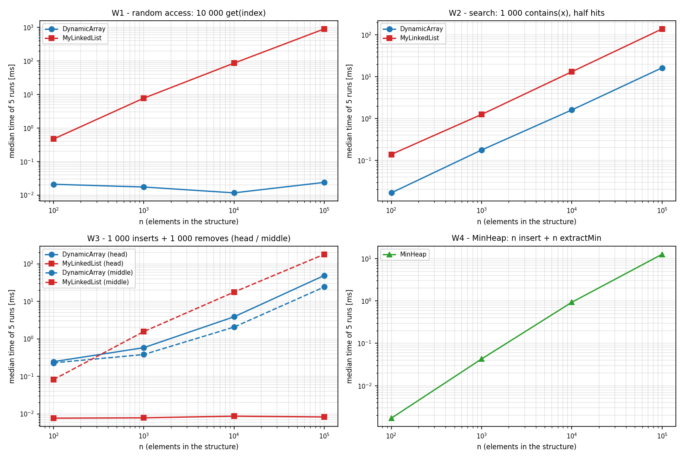
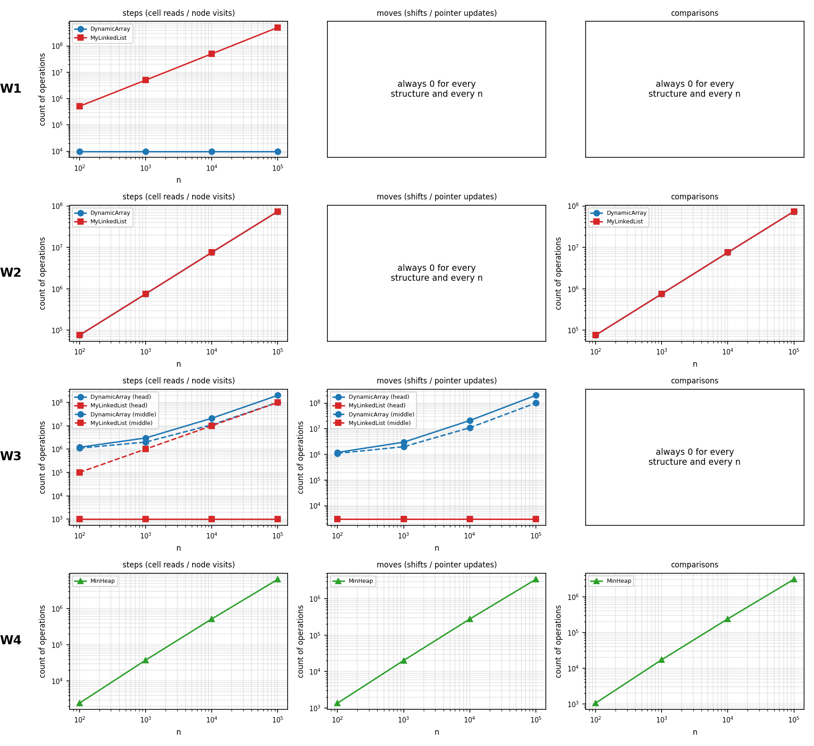
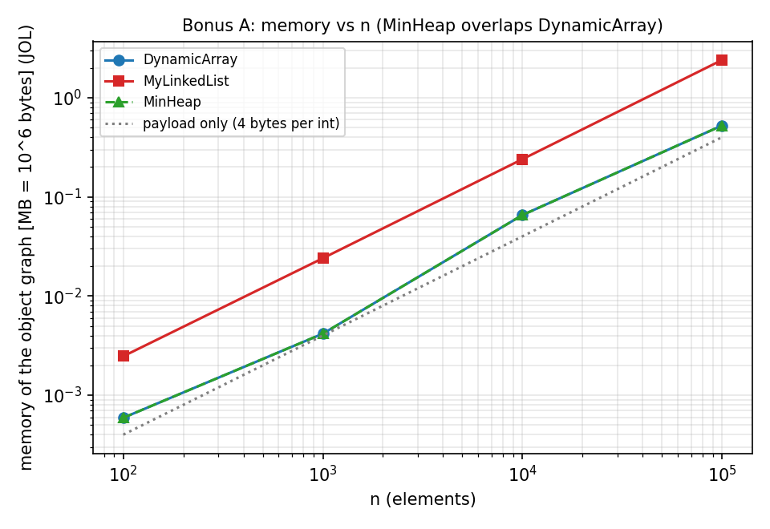
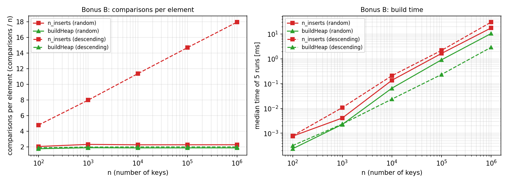

# Assignment 2 - Data Structures: Report

**Course:** Design and Analysis of Algorithms  **Author:** _name surname, group_

I wrote DynamicArray, MyLinkedList and MinHeap from scratch (only `int` and `int[]`, no java.util collections).
All times in this report were measured on an Intel Xeon 2.1 GHz (1 vCPU VM), L1 cache 48 KiB, L2 cache 2 MiB, OpenJDK 21. The raw data is in `results/results.csv`.

## 1. Complexity table

"Average" means a random valid index (for `contains`: a random position of the value, or a miss). I use Θ when the bound is tight. The extra space is O(1) for every row, except when the array grows: then a new array of size 2n is created for a moment (Θ(n)).

| Structure | Operation | Best | Average | Worst | Why |
|---|---|---|---|---|---|
| DynamicArray | `add(x)` | Θ(1) | Θ(1) amortized | Θ(n) | writes one cell; growing copies n elements but only after about n/2 cheap adds, all copies together are less than 2n |
| | `add(i,x)` | Θ(1) (i = n) | Θ(n) | Θ(n) | shifts n - i elements, at i = 0 all of them |
| | `remove(i)` | Θ(1) (last) | Θ(n) | Θ(n) | shifts n - i - 1 elements |
| | `get(i)` | Θ(1) | Θ(1) | Θ(1) | address is base + 4·i, no loop |
| | `contains(x)` | Θ(1) | Θ(n) | Θ(n) | stops at the first match, a miss checks all n |
| MyLinkedList | `add(x)` | Θ(1) | Θ(1) | Θ(1) | we have a tail pointer, so just 2 pointer writes |
| | `add(i,x)` | Θ(1) (i = 0 or n) | Θ(n) | Θ(n) | we must walk i nodes to find the previous node |
| | `remove(i)` | Θ(1) (i = 0) | Θ(n) | Θ(n) | need the previous node, for the last one we walk n - 1 |
| | `get(i)` | Θ(1) (i = 0) | Θ(n) | Θ(n) | walk i + 1 nodes from the head |
| | `contains(x)` | Θ(1) | Θ(n) | Θ(n) | same scan as the array, but node by node |
| MinHeap | `insert(x)` | Θ(1) | Θ(1) for random keys¹ | Θ(log n)² | bubble-up goes at most log₂n levels, a random key stays near the leaves |
| | `peekMin()` | Θ(1) | Θ(1) | Θ(1) | only reads `a[0]` |
| | `extractMin()` | Θ(1) (all keys equal) | Θ(log n) | Θ(log n) | bubble-down goes at most log₂n levels (2 comparisons each), the last element usually sinks down to a leaf |

¹ Measured: about 2.28 comparisons per insert, and it stays the same from n = 1 000 to n = 1 000 000 (`results/buildheap.csv`).
² A single insert that has to grow the array costs Θ(n), but amortized it is still Θ(log n).

## 2. Workloads, method and counters

**Workloads** (n = 100, 1 000, 10 000, 100 000; data always from `new Random(42)`):
- **W1:** fill with n values, then 10 000 random `get(index)`.
- **W2:** fill, then 1 000 `contains(x)`. Half of the queries are in the structure and half are not (the values are even numbers and the missing queries are odd numbers).
- **W3:** fill, then 1 000 inserts and 1 000 removes at index 0 (head) or at index n/2 (middle).
- **W4:** MinHeap. Insert n values, then `extractMin` n times and check that the results are in non-decreasing order.

Filling the structure is setup and is not timed or counted. First I do a warm-up (at least 3 runs and 300 ms, thrown away), then I run 5 times and save the **median** time. The counters are always the same between runs, and the program stops with an error if they are different, or if the array and the list give different answers.

| Counter | What we count |
|---|---|
| steps | one read of an array cell or one visit of a list node (a heap comparison counts as 2 reads) |
| moves | one element written into another cell (shift, copy when growing, append, swap = 2) or one pointer change |
| comparisons | one comparison between two elements (or element and key) |

The counters are counted in the code while it runs, not estimated later. The tests check exact values, for example `get(999)` in a list with 1 000 nodes must be 1 000 steps.

## 3. Loop invariants

### Proof 1: `contains(x)`

    for (i = 0; i < size; i++)
        if (data[i] == x) { found = true; break; }

**Invariant:** at the start of the iteration with index `i` (0 ≤ i ≤ size), `x` is not equal to any of `data[0..i-1]`.

- **Initialization:** for i = 0 the part `data[0..-1]` is empty, so the statement is true.
- **Maintenance:** assume it is true for `i` and i < size. If `data[i] == x` the loop stops with `break`. If not, then `data[i] != x`, so `x` is also not in `data[0..i]`, and after `i++` the invariant is true again.
- **Termination:** `i` grows by 1 every time and is at most `size`, so the loop runs at most `size` times (pos + 1 times for a hit, size times for a miss). The tests check exactly this.
- **Conclusion:** if we leave with `break`, then `data[i] == x`, so `true` is correct. If we leave with i = size, the invariant says `x` is not in the whole array, so `false` is correct. For the list it is the same with "the first i nodes".

### Proof 2: bubble-down in `extractMin` (`siftDown`)

Before the loop the last element was copied to the root and `size` was made smaller by 1. The parent of c is p(c) = (c-1)/2.

**Invariant:** at the start of each iteration
- (a) `a[p(c)] <= a[c]` is true for every index c ≥ 1 except the children of `i`, and
- (b) if i > 0, then `a[p(i)]` is ≤ both children of `i`.

- **Initialization (i = 0):** before `extractMin` the array was a heap. Only `a[0]` changed and one leaf was removed, so every pair whose parent is not the root is still correct. So (a) is true. (b) is true because the root has no parent.
- **Maintenance:** let `s` be the smaller child (the right one only if it is strictly smaller). If `a[i] <= a[s]`, then both pairs of `i` are fine, the whole array is a heap and the loop stops. Otherwise we swap `a[i]` and `a[s]`, so the new `a[i]` is the old `a[s]`. Now: (i, s) is fine because old a[s] < old a[i]; (i, other child) is fine because old a[s] ≤ a[other child] (we chose the smaller one); (p(i), i) is fine because of (b). So only the children of `s` can still be wrong, and this is (a) for `s`. For (b) with `s`: the new value in `i` is old a[s], and the children of `s` did not change and were already ≥ a[s] because of (a).
- **Termination:** each iteration goes one level down and the depth is at most log₂(size), so the loop runs at most log₂n times.
- **Conclusion:** the loop stops either with the `break` (the heap is correct, shown above) or because `2i+1 >= size`. Then `i` is a leaf, it has no children, and (a) says that every pair is correct. The elements are the same as before, only without the old root, which was the minimum. The cost is Θ(log n), like in the table.

## 4. Results

Results for n = 100 000 (median of 5 runs, the other n are in `results/results.csv`):

| Workload | Structure | time [ms] | steps | moves | comparisons |
|---|---|---:|---:|---:|---:|
| W1 `get` | DynamicArray / MyLinkedList | 0.024 / 905.6 | 10 000 / 505 028 648 | 0 / 0 | 0 / 0 |
| W2 `contains` | DynamicArray / MyLinkedList | 16.4 / 139.9 | 74 038 714 (both) | 0 / 0 | 74 038 714 (both) |
| W3 head | DynamicArray / MyLinkedList | 48.9 / 0.008 | 201 000 000 / 1 000 | 201 000 000 / 3 000 | 0 / 0 |
| W3 middle | DynamicArray / MyLinkedList | 24.1 / 179.9 | 101 000 000 / 100 001 000 | 101 000 000 / 3 000 | 0 / 0 |
| W4 | MinHeap | 12.7 | 6 452 583 | 3 390 807 | 3 060 760 |

I also fitted a line on the log-log plot of time vs n (n from 10³ to 10⁵). The slopes are: W1 array 0.07 and list 1.03; W2 about 1.0 for both; W3-head array 0.96 and list 0.01; W3-middle array 0.90 and list 1.03; W4 1.24. For W4 the counted operations have slope 1.12, and for n log n we expect about 1.11.

The first picture shows time vs n (one chart for each workload, both structures in the same chart). The second shows steps, moves and comparisons vs n. The same charts are also saved one by one in `results/plots/` (`W1_time.png`, `W1_ops.png`, and so on). A log axis cannot show 0, so the series that are always 0 are written in the panel.

## 5. Discussion (13 sentences)

In the array, `get(i)` is only one address calculation, so it always takes 1 step (10 000 steps for 10 000 calls, for every n). In the linked list we must walk i + 1 nodes from the head, which was about 505 million steps at n = 100 000 (around 50 500 per call). Because of this the list was about 38 000 times slower (0.024 ms against 906 ms). The array also keeps its elements next to each other, so one 64-byte cache line holds 16 ints and the next reads are usually already in the cache.

In W2 both structures do exactly the same 74 038 714 steps, but the list needed 140 ms and the array only 16 ms (1.89 ns against 0.22 ns per step). The main reason is pointer chasing: the CPU knows the address of the next node only after it has loaded the current node, so it cannot load things in parallel, but array loads do not depend on each other and can be prefetched. Memory also matters: JOL shows that one node is 24 bytes (12 header, 4 int, 4 reference, 4 padding) for only 4 bytes of data, so the list is 6 times bigger. In our test the cache effect was small (1.55 ns per step at n = 1 000 and 1.79 ns at n = 100 000), probably because the nodes were created one after another and are close to each other in memory. Also every node is a separate object that the garbage collector has to handle, but the array is only one object.

The linked list is better when we work at the head: in W3-head it needed only 4 000 counted operations (0.008 ms) and the array needed 200 million shifts (49 ms), so the list is good for stacks and queues. For the other workloads the array is the better default, and in W3-middle it was even 7.5 times faster (24 ms against 180 ms), although both are Θ(n) there. The MinHeap is better when we always need the smallest element (W4): n inserts and n `extractMin` took only 12.7 ms at n = 100 000, and with a list it would be Θ(n²), about 10 s if we use 1.9 ns per node visit (this is only an estimate, I did not measure it). The heap is not good for searching (`contains` is Θ(n)) and we cannot read it in sorted order without emptying it.

## 6. Bonus

### A: memory (JOL)
Bytes per element for n = 100, 1 000, 10 000, 100 000 (the data itself is 4 bytes per int):

| Structure | n = 100 | 1 000 | 10 000 | 100 000 |
|---|---:|---:|---:|---:|
| DynamicArray = MinHeap | 5.92 | 4.18 | 6.56 | 5.24 |
| MyLinkedList | 24.72 | 24.07 | 24.01 | 24.00 |

For n = 100 000 this is 0.52 MB for the array, 2.40 MB for the list, and only 0.40 MB of real data. The array is between 1.04 and 1.64 times the data size, because its capacity is 8·2^k, so there can be up to 2 times free space right after it grows, and the array has a 16-byte header. The list is always 6 times the data size. Each node has a 12-byte object header, the 4-byte int, a 4-byte reference and 4 bytes of padding to reach a multiple of 8, so the header and pointer are bigger than the data. The plot is `bonus_memory_mb.png` (MB vs n) and the JOL layouts are in `results/jol_layouts.txt`.

### B: buildHeap (Floyd) against n inserts
`buildHeap` uses at most 2n comparisons: a node with height h costs at most 2h comparisons, and there are at most n/2^(h+1) nodes with height h, so the sum is at most 2n·Σ h/2^(h+1) = 2n.

| input, n | inserts: comparisons per element | buildHeap: comparisons per element | inserts [ms] | buildHeap [ms] |
|---|---:|---:|---:|---:|
| random, 10⁶ | 2.28 | 1.88 | 17.6 | 10.5 |
| descending, 10⁶ | 17.95 | 2.00 | 30.2 | 2.93 |

With random keys most new elements stay near the leaves, so n inserts cost only about 2.3n comparisons and `buildHeap` is just 1.7 times faster. The O(n log n) case happens with descending keys, because every new element goes up to the root (the cost per element grows from 4.8 to 18 when n grows), and there `buildHeap` is 10 times faster.

 

## 7. Problems and limits

Very small times (below about 0.05 ms, for example W1 on the array) are not reliable, because of the timer and the JIT, and they changed up to 2 times between runs. For these cases the counters are the better proof. Bigger times were the same within about 20% in three full runs. The times depend on the computer, but the slopes and the array vs list ratios should be similar on other computers. I used normal loops for shifting (not `System.arraycopy`), so the counters are exact.
